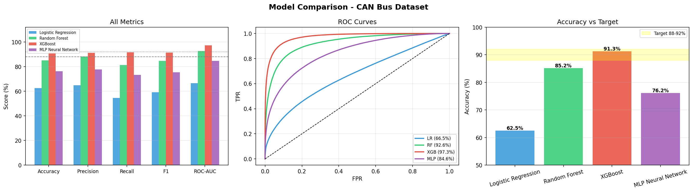

# 🚗 CAN-ShieldNet — CAN Bus Intrusion Detection System

Machine-learning intrusion detection for in-vehicle **CAN Bus** networks, benchmarked on three public datasets — **ROAD**, **OTIDS (HCRL)** and **SynCAN** — covering fuzzing, replay/DoS, spoofing, impersonation and masquerade attacks.

**Headline result:** XGBoost reaches **91.30 % accuracy (ROC-AUC 97.31)** on SynCAN with a mean inference latency of **0.15 ms per message** — well inside real-time constraints for in-vehicle systems.



## Pipeline

```
raw CAN frames ─► parse & clean ─► feature engineering ─► 4 models ─► evaluation ─► cross-vehicle transfer ─► real-time simulation
                                   (timing, payload,       LR · RF ·
                                    entropy, Hamming)      XGBoost · MLP
```

Engineered features (20) include signal statistics (`sig_mean/std/min/max/range/entropy`), inter-arrival timing (`iat`, `iat_zscore`, `freq_dev`), payload change (`hamming_dist`, `payload_change`) and rolling-window aggregates.

## Results

### Per dataset (best model in bold)

| Dataset | Logistic Reg. | Random Forest | XGBoost | MLP |
|---|---|---|---|---|
| **SynCAN** | 62.52 % | 85.16 % | **91.30 %** (AUC 97.31) | 76.16 % |
| **OTIDS** | 69.23 % | 85.55 % | **86.05 %** (AUC 95.16) | 81.04 % |
| **ROAD** | 56.11 % | **75.27 %** (AUC 84.54) | 74.99 % | 68.20 % |

Full metric tables (precision, recall, F1, ROC-AUC, per-attack breakdowns) are in [`results/`](results/).

### Inference latency (ms per message)

| Model | Mean | Median | p95 | p99 |
|---|---|---|---|---|
| XGBoost | 0.150 | 0.145 | 0.208 | 0.319 |
| MLP | 0.030 | 0.029 | 0.031 | 0.034 |
| Random Forest | 13.32 | 13.34 | 13.77 | 14.48 |

### Cross-vehicle generalisation

Models trained on one vehicle (OTIDS) were tested on a different vehicle (ROAD) zero-shot, then fine-tuned with 10 % and 50 % of ROAD data. Accuracy drops sharply without adaptation (XGBoost 52.5 % zero-shot → 55.8 % with 50 % transfer), showing that **CAN IDS models are strongly vehicle-specific** — an important finding for real-world deployment. See [`results/cross_vehicle_results.csv`](results/cross_vehicle_results.csv).

## Repository layout

```
src/
  road_pipeline.py                  # ROAD: parse → clean → features → train/evaluate 4 models
  otids_pipeline.py                 # OTIDS (HCRL Car-Hacking) pipeline
  syncan_pipeline.py                # SynCAN pipeline
  cross_vehicle_generalization.py   # zero-shot / few-shot transfer OTIDS → ROAD
  realtime_simulation.py            # message-by-message streaming + latency benchmark
results/                            # metric tables (CSV)
figures/                            # ROC curves, confusion matrices, feature importance, dashboards
```

## Getting started

```bash
pip install -r requirements.txt
```

Download the datasets (not included — they are large and have their own licences) into `data/`:

| Dataset | Source | Put it in |
|---|---|---|
| ROAD | https://0xsam.com/road/ | `data/road/` |
| OTIDS / Car-Hacking | https://ocslab.hksecurity.net/Datasets | `data/otids/` |
| SynCAN | https://github.com/etas/SynCAN | `data/syncan/` |

Then run, in order:

```bash
python src/road_pipeline.py
python src/otids_pipeline.py
python src/syncan_pipeline.py
python src/cross_vehicle_generalization.py   # needs ROAD + OTIDS outputs
python src/realtime_simulation.py            # needs OTIDS outputs
```

Each script writes models, feature parquets and figures to `outputs/<dataset>/`.

## Tech stack

Python · XGBoost · scikit-learn · pandas · NumPy · Matplotlib · Seaborn

## Author

**Tarun Pradeep** — [LinkedIn](https://linkedin.com/in/tarunp11)
